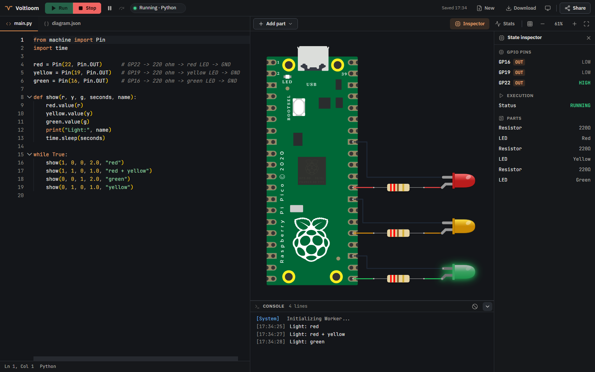
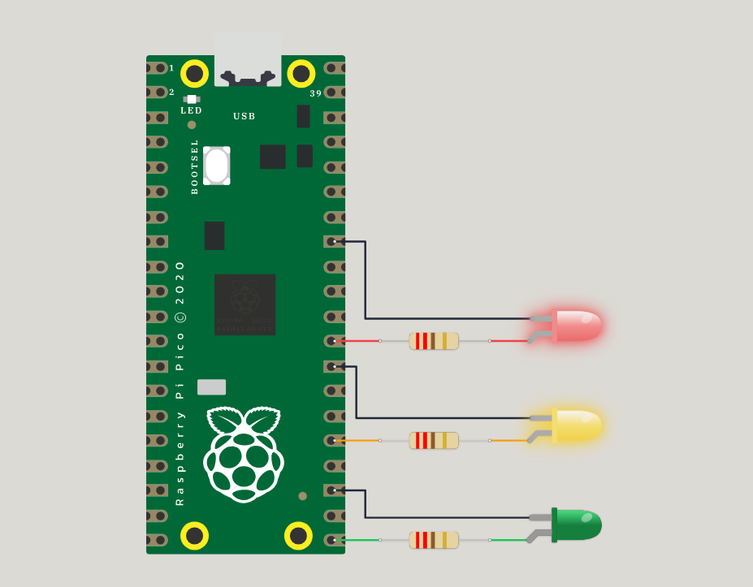
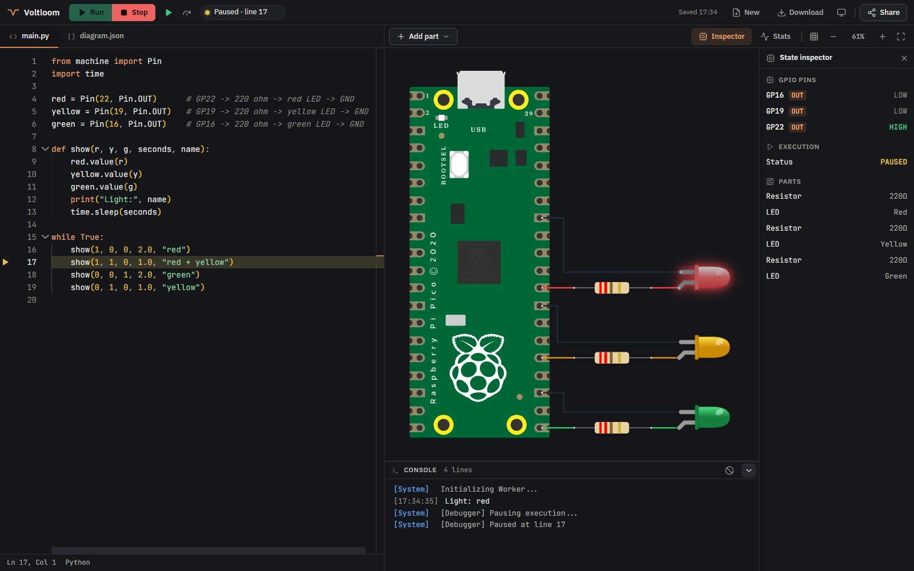
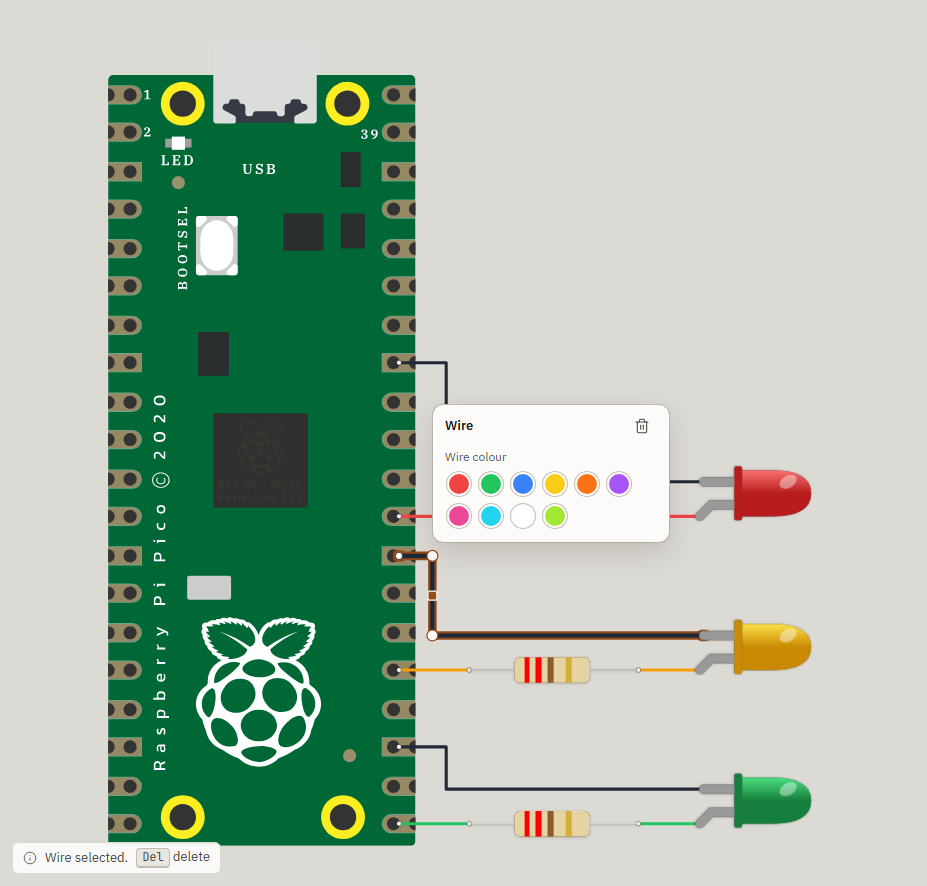
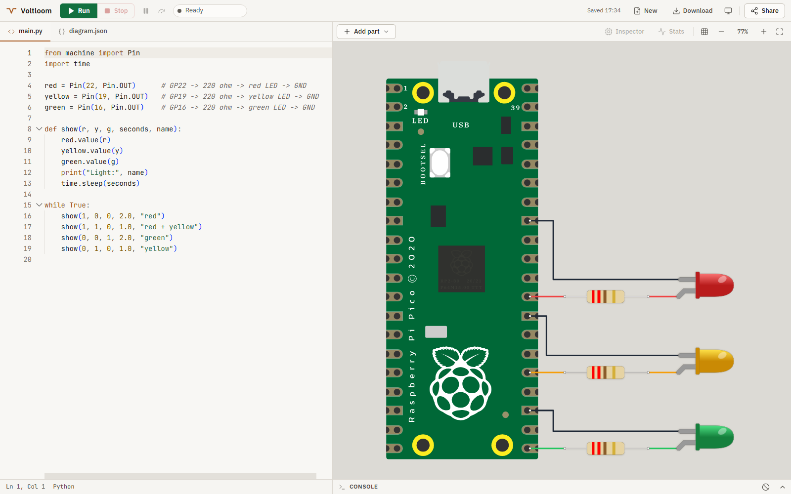
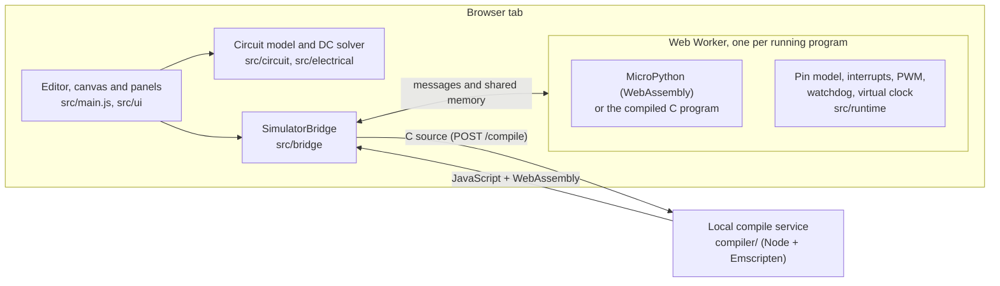

# Voltloom

**Build Raspberry Pi Pico circuits in your browser, then run real MicroPython or C programs against them.**

Voltloom is a browser workbench for Pico projects. Place a Pico, LEDs, resistors and push buttons on a canvas, wire them, write a program, and press **Run**. The program drives virtual GPIO pins, a DC circuit solver works out the currents and voltages, and the LEDs light up accordingly: change a resistor and the LED gets brighter or dimmer.

It is meant for learning, prototyping and teaching embedded basics without hardware on the desk, and for testing small firmware ideas quickly.



> **Status: a working prototype.** Everything listed as working below is covered by automated tests; what is missing is listed under [Limitations](#limitations). Voltloom is a *behavioural* simulator of the Pico SDK and MicroPython APIs, not an RP2040 emulator: no ARM code runs, and the electrical model is DC only.

## Features

- **Circuit canvas.** Raspberry Pi Pico W board, LEDs (10 colours), resistors and 4-pin push buttons. Drag, rotate, flip, zoom and pan.
- **Wiring like Wokwi.** Click a pin, click empty canvas to place corners, click another pin to finish. Wires without corners are routed automatically with tidy right-angle paths that avoid the board, the parts and each other. Any wire can be reshaped later by dragging its handles.
- **Live electrical model.** Resistor values, colour-dependent LED forward voltages, GPIO pad and rail resistances. Selecting a part shows its current, voltage and power, and overloads, shorts and contention are flagged with numbers.
- **MicroPython** (bundled MicroPython 1.27 WebAssembly build): `machine.Pin` including interrupts, `machine.PWM`, `machine.WDT`, `reset_cause`, `time` / `utime`.
- **C with Pico SDK-style APIs** (optional local compile service using Emscripten): GPIO including bulk calls, pulls, interrupts, PWM, watchdog, `absolute_time_t` helpers, a simulated filesystem and Wi-Fi.
- **Accurate timing.** A virtual clock: real time in the browser, instant and repeatable in tests. Interrupts fire at the virtual time of the edge, even in the middle of a sleep.
- **Debugger (Python).** Breakpoints in the gutter, Pause, Resume and Step, and a state inspector with live pin levels, PWM and parts.
- **Projects.** Autosave in the browser, shareable links that contain the whole project, and a downloadable program.
- **Light and dark themes**, keyboard shortcuts, and a layout that adapts to narrow windows.

## What you can build

The [examples](docs/examples.md) open as ready-made projects, and each one is verified by the test suite. They include:

- **Traffic light**: three LEDs on GP22, GP19 and GP16 cycling red, red + yellow, green, yellow.
- **Blink**: the classic first program on GP15.
- **Button-controlled LED**: by polling, and with a GPIO interrupt.
- **PWM fade**: an LED dimmed by changing the PWM duty cycle.
- **Watchdog**: a program that stops feeding the watchdog and is reset.
- **The same circuits in C**, using Pico SDK calls such as `gpio_put`, `gpio_set_irq_enabled_with_callback` and `pwm_set_gpio_level`.

| A traffic light | Paused in the debugger |
|---|---|
|  |  |

| Reshaping a wire | Light theme |
|---|---|
|  |  |

## Getting started on Windows

You need **Node.js 24** (24.12 or newer in the 24 line; other major versions are refused by `package.json`) and **npm**. Git is optional; you can download the ZIP instead.

1. Install Node.js 24 from [nodejs.org](https://nodejs.org/en/download) (choose a 24.x release), or with [nvm-windows](https://github.com/coreybutler/nvm-windows): `nvm install 24.12.0`, then `nvm use 24.12.0`.
2. Get the code and install the dependencies (PowerShell):

   ```powershell
   git clone https://github.com/Neeraj-nk3/Voltloom.git voltloom
   cd voltloom
   npm run setup        # checks Node and npm, runs `npm ci`, then checks your environment
   ```

3. Start the app:

   ```powershell
   npm run dev          # http://localhost:5173/
   ```

4. Open http://localhost:5173/ in a Chromium-based browser (Chrome or Edge). The editor and fonts load from CDNs, so the first load needs internet access.

`npm run doctor` checks your machine at any time and says how to fix anything that is missing.

**Try an example without wiring anything.** This prints a link that opens the traffic light with its circuit and code:

```powershell
node scripts/share-link.mjs examples/projects/python-traffic-light.project.json
```

Open the link, press **Run**, and watch the lights change. [docs/getting-started.md](docs/getting-started.md) walks through building a circuit yourself and explains every part of the workbench.

### Optional: C programs (Emscripten)

Python needs nothing else. To run **C** programs you also need the [Emscripten SDK](https://emscripten.org/docs/getting_started/downloads.html) (version 6.0.12 was used for testing) and the local compile service:

```powershell
# once: install and activate Emscripten (in a folder of your choice)
git clone https://github.com/emscripten-core/emsdk.git
cd emsdk
.\emsdk.bat install 6.0.12
.\emsdk.bat activate 6.0.12

# each time, in a second terminal in the voltloom folder, with Emscripten on PATH
# (run emsdk_env.ps1 from the emsdk folder, or set EMCC_PATH to emcc.exe instead)
npm run compiler     # the compile service at http://127.0.0.1:3001/
```

With the service running, **Run** on a C program compiles it on your machine and runs it in the browser. The service only listens on `127.0.0.1` and is not a sandbox; do not expose it to a network. More detail and troubleshooting: [docs/setup-and-troubleshooting.md](docs/setup-and-troubleshooting.md).

## How it works



- **The page** (`src/main.js`, `src/ui/`) holds the Monaco editor, the circuit canvas, wiring and the panels. It solves the circuit (`src/electrical/`) and draws the result.
- **Each program runs in its own Web Worker** (`src/runtime/`). Stop terminates the worker, so even `while True: pass` cannot freeze the page. Python and C share one pin, board and clock model, so they behave the same.
- **Live input** (button presses, circuit changes) reaches a running program through shared memory, which needs a cross-origin-isolated page. The dev and preview servers send the required headers.
- **The compile service** (`compiler/`) turns C into WebAssembly with Emscripten. It is optional and local.
- **A scenario runner** (`src/scenario/`) runs the same runtimes in Node with scripted button presses, for repeatable tests.

The full picture is in [docs/architecture.md](docs/architecture.md).

## Commands

| Command | What it does |
|---|---|
| `npm run setup` | install dependencies and check the environment (`npm run setup -- --dry-run` installs nothing) |
| `npm run doctor` | check Node, npm, dependencies, the bundled runtime, a test browser, Emscripten and the ports |
| `npm run dev` | the app with hot reload, at http://localhost:5173/ |
| `npm run compiler` | the local C compile service, at http://127.0.0.1:3001/ |
| `npm run build` / `npm run preview` | production build in `dist/` / serve it at http://localhost:4173/ |
| `npm run demo` | run every example headlessly and print what it did |
| `npm run examples:build` / `npm run examples:check` | regenerate / verify `examples/projects/*.project.json` |

## Tests

```powershell
npm test                                         # unit and scenario tests (Vitest)
npx playwright install chromium-headless-shell   # once, for the browser tests
npm run test:e2e                                 # browser tests (Playwright, Chromium) against the dev server
npm run build; npm run test:e2e:preview          # the same browser tests against the production build
```

Tests that need a C compiler are **skipped, not failed**, when Emscripten is not found. Set `EMCC_PATH` (and run `npm run compiler`) to include them. What each layer covers: [docs/testing.md](docs/testing.md).

## Project structure

```
src/                 the app
  main.js            page wiring: editor, toolbar, tabs, project restore
  ui/                canvas, wiring and routing, part views, panels, styles, themes
  circuit/           part registry, wire registry, diagram.json export (no DOM)
  electrical/        DC solver, LED model, board and netlist
  runtime/           firmware workers: python/, c/, common/ (pin model, interrupts, PWM, watchdog)
  bridge/            runs a program in a worker; compile-service client
  project/           project format, migrations, autosave
  clock/, debug/, hardware/, scenario/, worker-protocol/, shared/
compiler/            local C -> WebAssembly service (npm workspace) with Pico SDK-compatible headers
runtimes/micropython bundled MicroPython WebAssembly build and its licence
examples/            python/, c/, projects/ (ready to open), examples.json (expected behaviour)
tests/               Vitest (tests/unit/, tests/scenario/), Playwright (tests/e2e/), fixtures, support
scripts/             setup, doctor, demo, share-link, example builder
docs/                guides, decisions/, assets/ (screenshots)
```

## Documentation

| Guide | |
|---|---|
| [Getting started](docs/getting-started.md) | your first circuit, and a tour of the workbench |
| [Setup and troubleshooting](docs/setup-and-troubleshooting.md) | prerequisites, Emscripten, common failures |
| [Examples](docs/examples.md) | the verified Python and C examples and their circuits |
| [Architecture](docs/architecture.md) | how the parts fit together |
| [Electrical model](docs/electrical-model.md) | what is solved, every parameter and its source |
| [SDK compatibility](docs/sdk-compatibility.md) | exactly which MicroPython and SDK calls exist |
| [Timing and simulation](docs/timing-and-simulation.md) | the virtual clock, interrupt timing, the scenario runner |
| [Project format](docs/project-format.md) | the saved project file, migration, autosave |
| [Deployment and security](docs/deployment-and-security.md) | hosting, cross-origin isolation, security boundaries |
| [Testing](docs/testing.md) | the test layers and how to run them |
| [Limitations and roadmap](docs/limitations-and-roadmap.md) | what is missing or deferred |

## Contributing

Contributions are welcome. [CONTRIBUTING.md](CONTRIBUTING.md) explains the setup, which tests to run for which change, and how claims in the docs are kept honest. Please report security problems privately as described in [SECURITY.md](SECURITY.md).

## Limitations

The full list is in [docs/limitations-and-roadmap.md](docs/limitations-and-roadmap.md). The most important:

- **DC only.** No capacitors, inductors or transients. LED forward voltages, pad and rail resistances and the brightness curve are documented assumptions, not measurements of a particular part.
- **Python `machine` has `Pin`, `PWM` and `WDT` only.** There is no `ADC`, `I2C`, `SPI`, `UART` or `Timer`, and no displays or other peripherals. The debugger is Python only.
- **Interrupts are seen at observation points**: when virtual time passes or a pin changes. A loop that does neither (`while (!flag) {}`) never sees one.
- **Live input needs cross-origin isolation.** On a host that does not send the COOP/COEP headers, Python still runs in an announced *Limited mode*, but button presses and interrupts do not reach a running program, and C does not run.
- **The editor and fonts come from CDNs**, so the editor needs internet access.
- **One program per project**; C++ is not supported.
- **Tested in Chromium on Windows with Node 24 only.** Firefox, Safari, macOS, Linux and touch devices are untested. The GitHub Actions workflow in `.github/workflows/ci.yml` has never been run.
- Reshaping wires and dragging parts need a mouse; keyboard-only circuit editing is not supported.

## License

Voltloom is released under the [MIT License](LICENSE), Copyright (c) 2026 Neeraj Kumar. It bundles MicroPython (MIT) and icon shapes from Lucide (ISC), and loads Monaco and fonts from CDNs. [THIRD_PARTY_NOTICES.md](THIRD_PARTY_NOTICES.md) lists what is included, what is only loaded, and what has been verified.

Raspberry Pi and Pico are trademarks of Raspberry Pi Ltd. Voltloom is an independent project and is not affiliated with, sponsored by or endorsed by Raspberry Pi Ltd.
