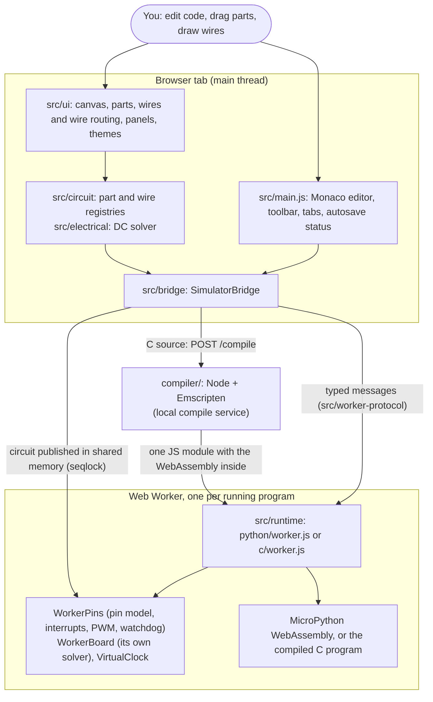

# Architecture

Voltloom is a browser app plus a small local compile service. This guide says which part does what, how data moves between them, and where the limits are. Paths are relative to the repository root. Every behaviour described here is covered by a test unless it is listed under "Not modelled" or in [limitations-and-roadmap.md](limitations-and-roadmap.md).

## 1. The big picture

Two ideas organise everything:

1. **A program never touches the page.** Python and C each run in their own Web Worker. Stop is `Worker.terminate()`, so nothing a program does (including `while True: pass`) can survive Stop or freeze the page.
2. **Python and C share one hardware model.** Both workers are thin plumbing over the same `WorkerPins`, `WorkerBoard` and `VirtualClock`, so a pin read, an interrupt or a PWM setting behaves the same in both languages (`tests/e2e/pin_parity.spec.js` checks this in the browser).

## 2. Source layout (`src/`)

| Folder | Responsibility | Touches the DOM? |
|---|---|---|
| `main.js` | Start-up: editor, toolbar, tabs, project restore, autosave status, test hook `window.__voltloom` | yes |
| `ui/canvas/` | The circuit canvas: board SVG, pins, parts, pan and zoom, the properties card (`canvas-manager.js`); click-to-wire interaction and wire lifecycle (`wire-interaction-manager.js`); how a wire is drawn (`wire-view.js`); automatic schematic-style routing of all wires together, an obstacle-aware A* search on a sparse grid (`wire-router.js`); hand-made wire shapes, drawn with clicked corners or reshaped with handles, kept square and attached to their pins (`wire-edit.js`); the maths of zoom, fit, rotated pin positions and floating-card placement as pure functions (`geometry.js`, unit-tested) | yes |
| `ui/styles/` | The look of the whole interface as plain CSS in cascade layers: `tokens.css` (the only place colours, type sizes, spacing, radii, stacking order and motion are defined; one block per theme, dark and light, selected by `<html data-theme>` which `public/theme-init.js` sets before first paint), `base.css`, `components.css` (buttons, tabs, menus, dialog, tooltip...), `panels.css` (console, inspector), `layout.css` (title bar, panes, splitters, narrow-window behaviour), `canvas.css`. `tests/unit/ui/design-tokens.test.js` checks the contrast of the colour pairs | – |
| `ui/` (top level) | Behaviour shared by the interface: `layout.js` (splitters, Code/Circuit switch, console), `tooltip.js`, `popover.js`, `menu.js`, `hint.js`, `icons.js` (the icon sprite lives at the top of `index.html`), `theme.js` (System / Light / Dark), `editor-theme.js` (the matching Monaco themes), `storage.js` (per-viewer preferences such as pane sizes and the canvas viewport; never part of a project) | yes |
| `ui/parts/` | How each part type looks and is edited: LED, resistor (colour bands), push button (`part-views.js` is the lookup table) | yes |
| `ui/panels/` | Serial monitor (`serial-monitor.js`, `serial-output.js`), state inspector, performance monitor | yes |
| `ui/assets/` | `pico-board.svg`, the drawing of the board | – |
| `circuit/` | What the circuit *is*: the part registry (`part-types.js`), `diagram.json` builder, the wire registry, structural checks (`circuit-validator.js`), the board's pin table | no |
| `electrical/` | The DC circuit model: netlist builder, MNA/Newton solver, LED model, board parameters, limits and warnings, readout text, the shared-memory circuit channel | no |
| `project/` | Project format v2, migration from v1, storage and share links, honest autosave | no |
| `hardware/` | Main-thread record of GPIO / PWM / Wi-Fi / filesystem / reset state, used by the inspector and the bridge (`*-sim.js` = state, `*-bridge.js` = the API the bridge calls) | no |
| `debug/` | Python breakpoint / step debugger (UI side and the shared-memory pause channel) | no |
| `worker-protocol/` | The contract between the page and a worker: message types, shared-memory layout, the blocking RPC mailbox, the "floating" pin level | no |
| `clock/` | `VirtualClock` | no |
| `runtime/python/` | The Python worker and what it runs: the simulated `machine` module, `time` / `utime` on the virtual clock, debugger line checkpoints | no |
| `runtime/c/` | The C worker and the functions the compiled program calls (`Module._sim_*`) | no |
| `runtime/common/` | Shared by both: `WorkerPins` (`pin-model.js`), `WorkerBoard` (`board-runtime.js`), interrupts, watchdog, PWM frequency maths, event batching | no |
| `bridge/` | `SimulatorBridge` (starts, stops and restarts a program, applies its events, publishes the circuit, shows results) and the compile-service client | uses the DOM through `ui/` |
| `scenario/` | The deterministic Node runner (see §7) | no |
| `shared/` | IDs, HTML escaping, colour tables | no |

Most of `src/` has no DOM access, which is why the same code runs in the browser, in workers and in Node tests. `tests/unit/architecture/registry-boundary.test.js` enforces one boundary: only `circuit/part-types.js` and `circuit/diagram.js` know how part ids are spelled.

## 3. Starting a program

`SimulatorBridge.run()` / `runC()` (`src/bridge/simulator-bridge.js`):

1. Tears down any previous worker, resets the main-thread hardware state and debugger.
2. Allocates shared memory: pin levels, the **circuit channel**, a debug area, an RPC mailbox. This needs a cross-origin-isolated page (see [deployment-and-security.md](deployment-and-security.md)). Without isolation the app announces *Limited mode* and runs Python without live input.
3. For C: posts the source to the compile service (`bridge/compile-client.js`) and gets back a single JavaScript module.
4. Creates the worker and sends `init` (buffers, clock mode, reset cause), then `run`.
5. From then on: receives batched events (`pin.write`, `stdout`, `pwm`, `irq.fired`, `reset` …) and applies them to the `hardware/` state; after each batch it re-solves the circuit **for display** and updates LEDs, readouts and warnings.

`stop()` terminates the worker, resets the simulated hardware and re-solves the circuit with no program, so LEDs reflect the idle board. `restart(kind)` handles a reset the *program* asked for (`machine.reset()`, an expired watchdog, `watchdog_reboot()`): fresh hardware, same program, virtual time back to 0; more than 10 resets in 5 s stops the simulation.

## 4. The electrical model (`src/electrical/`)

A circuit is the canvas parts plus wires plus the state of every GPIO pad. `netlist.js` turns it into a solver circuit (wires merge pins into one node; all GND pins are node 0; the 3V3 / VBUS / VSYS rails are sources behind a resistance; every GPIO pad is a source when driven or a pull resistor when an input). `solver.js` finds the DC operating point with Modified Nodal Analysis and Newton–Raphson (SPICE-style tolerances, junction-voltage limiting, gmin and source stepping as fallbacks). `circuit-engine.js` adds read thresholds with hysteresis and the warnings (`limits.js`). Parameters and their sources are in [electrical-model.md](electrical-model.md).

**Two solvers.** The worker solves the circuit to answer the program's pin reads (`WorkerBoard`); the main thread solves its own copy to draw the LEDs and warnings (`SimulatorBridge.updateCircuit`). Both use the same code. They can disagree only in the 0.8–2.0 V undefined band, where each keeps its own hysteresis memory. This is a documented limitation.

**Circuit channel.** A program busy in a loop cannot receive messages, so the main thread publishes the circuit (parts, wires, pressed buttons) into shared memory with a seqlock (`circuit-channel.js`): the writer makes the sequence number odd while writing; a reader accepts a copy only if the number is even and unchanged. Edits and button presses therefore reach a running program at once.

## 5. Pins, interrupts, PWM, watchdog (`src/runtime/common/`)

`WorkerPins` is the worker-side view of the 30 GPIOs, with state per GPIO as on the chip. Reads of an output return the written level; reads of an input ask `WorkerBoard`, so they reflect pull resistors, other pads on the same net and PWM. `IrqController` detects edges and levels by comparing a pin's level at *observation points* (every sleep slice, pin or clock read, program write, and every circuit change) and queues the handler. `PwmEngine` (in `hardware/pwm-sim.js`) and `pwm-frequency.js` plan divider and wrap like MicroPython. `WatchdogTimer` runs on the virtual clock. Events to the page go through `event-batcher.js`, so a program that floods output cannot freeze the page.

## 6. Time: the virtual clock (`src/clock/virtual-clock.js`)

A program sees only its own clock. `sleep` adds exactly the requested time; every pin or clock read costs 1 µs of virtual time, so a busy-wait always progresses and always ends at the same virtual instant. In `realtime` mode (the UI) sleeps wait for the wall clock; in `fast` mode (tests) nothing waits. A sleep proceeds in slices that stop at *wake points* (scripted inputs, watchdog deadlines) so interrupts run at the virtual time of their edge, in the middle of a sleep. Details and limits: [timing-and-simulation.md](timing-and-simulation.md).

## 7. The scenario runner (`src/scenario/`)

`runScenario({ language, code, components, connections, script, untilMs })` runs a program in a Node worker thread on the same runtimes, pin model and solver, with the clock in `fast` mode and scripted button presses or resistor edits applied by the clock itself at their virtual time. It returns the trace of every event with its virtual time, the printed lines, and the solved circuit. Identical inputs give identical traces. The unit/scenario tests, `npm run demo` and the example tests are built on it.

## 8. The compile service (`compiler/`)

`server.js` (Express) exposes `POST /compile` and `GET /health`. It binds to `127.0.0.1`, checks the `Host` and `Origin` headers against an allow-list, limits the source size, and runs one build at a time with a short queue. `lib/compile.js` then:

1. `source-policy.js` rejects `#include`s outside the standard headers and the SDK-compatible headers.
2. Runs `emcc -E` on the user's file only, recording every file the preprocessor read.
3. Backstops: every file read must lie in the temp workspace, the SDK headers or the toolchain; inline assembly is refused.
4. Compiles the *preprocessed* text (so what was checked is what is built) together with the C bridge files in `compiler/sdk/src/`, linking `js-library.js`, into one ES module with the WebAssembly embedded (`-sSINGLE_FILE`).

`compiler/sdk/include/` holds the SDK-compatible headers (names and signatures follow the Raspberry Pi Pico SDK so programs written for a Pico compile unchanged); `compiler/sdk/src/*.c` implement them by calling into `js-library.js`, which forwards to `runtime/c/runtime.js` inside the worker. What exists and what does not: [sdk-compatibility.md](sdk-compatibility.md). **The service is not a sandbox**; see [deployment-and-security.md](deployment-and-security.md).

## 9. Projects and persistence (`src/project/`)

A project is JSON (format v2: wire ids, `meta`). Everything read from a share link (`?p=`) or from browser storage is untrusted and goes through `validateProject()`, which first migrates v1 → v2 (`project-migrations.js`) and then checks every field. Autosave (`autosave.js`) writes to `localStorage` (else `sessionStorage`, else nowhere), reads the stored text back, and only then reports *Saved*; failures say why. Details: [project-format.md](project-format.md).

## 10. Not modelled

DC only (no capacitors, inductors or transients); no ADC, I2C, SPI, UART, PIO, DMA, timers or multicore; no RP2040 instruction-level emulation, so virtual time says nothing about how fast code would run on the chip. See [limitations-and-roadmap.md](limitations-and-roadmap.md).
